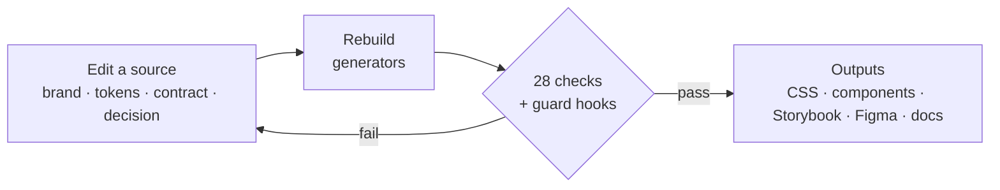

<div align="center">


# Sketchbook

**Start with a working design system. Make it yours.**<br />
Choose a starter, change the sources your team owns, and use the Sketchbook CLI to rebuild and check your work.

<br />

[](https://sketchbook-docs.vercel.app)
[](https://www.npmjs.com/package/@usesketchbook/cli?activeTab=readme)


[Quick start](#quick-start) · [Contributing](./CONTRIBUTING.md) · [How it works](#how-it-works) · [Evidence](#evidence) · [Use cases](#what-you-can-do-with-it) · [Public docs](https://sketchbook-docs.vercel.app/)

</div>

<br />

## What is Sketchbook

Sketchbook gives your team a workflow for building and maintaining a design system. It ships a CLI, a reference Web Components library, and starters you can adapt to your brand. The harness connects your design-system spec to generated outputs, checks, and instructions that coding agents can follow.

| Part | What it is |
| --- | --- |
| **Sources of truth** | Brand config, semantic tokens, one contract per component, a decision log. You edit these. |
| **Generators** | Rebuild foundation tokens, CSS, component styles, Storybook and the Figma file from the sources. |
| **Checks** | 28 deterministic checks (including one maintainer-only check): tokens, contrast, contracts, drift, white-label, decisions and more. |
| **Gates** | A new component stops at a planning gate, is built test-first, and is reviewed before it leaves beta. |
| **Agent guidance** | Portable project instructions and task workflows, plus the existing Claude Code rules, skills, commands and hooks. |
| **Outputs** | Tokens, a Web Components library, 8 page templates, Storybook, a Figma file and docs. The default library follows [shadcn/ui](https://ui.shadcn.com) and is a starting point you can edit or replace. |

Bring your tokens or an existing app, or start with the library and change it as you go.

## Quick start

Use Node.js 26.13.1 LTS and npm 12.2.3. See the [contributor setup instructions](./CONTRIBUTING.md) for patched versions on older LTS lines. Create a design system with [`@usesketchbook/cli` on npm](https://www.npmjs.com/package/@usesketchbook/cli).

```sh
mkdir my-design-system
cd my-design-system
npm exec --yes --package=@usesketchbook/cli -- sketchbook init --start library --dry-run
npm exec --yes --package=@usesketchbook/cli -- sketchbook init --start library
npx sketchbook check
```

Run `npx sketchbook` in a terminal to explore the interactive menu. Choose a number and press Enter; previews appear before changes, and Enter cancels at the confirmation prompt. Use `npx sketchbook help <command> --details` for the full command reference.

`init` adds the CLI as a dev dependency of the design-system project. For an existing app, add `--adopt` to `init` and run it from the app directory. To bring your own tokens, use `--start import --from <tokens file>`. See the [Quickstart](https://sketchbook-docs.vercel.app/start/quickstart/) for all seven starters and the [upgrade guide](https://sketchbook-docs.vercel.app/guides/adopt-in-app/#upgrade) for updating the CLI and harness.

Plain `init` creates a core-only project and writes its initial inventory to `docs/harness.md`. Add `--agent <profile>` to install the shared `contract-author` and `component-builder` skills and your client's setup. For example, `--agent claude` stages Claude Code, and `--agent codex,trae` selects both integrations. The same flag adds profiles to an existing project. Run `npx sketchbook doctor` to inspect your setup, then confirm what your client loaded. [Agent compatibility guide](./docs/agent-compatibility.md)

## Work on this repository

From the checkout root, run `npm ci` and then `npm run storybook` for the reference library or `npm run docs:build` for the public docs. The [contributor guide](./CONTRIBUTING.md) maps the engine, reference library, and docs app and lists the verification commands.

## How it works

Edit the source that owns the change, then rebuild. If a check finds drift, its result points you back to what needs attention.



Use this workflow to design a new component when the planning and test-first gates are enabled.

1. **Contract.** `contract.json` and `contract.md` describe the API, tokens and accessibility. `npm run check` must pass.
2. **Plan.** `plan.md` states scope, files, tokens, accessibility approach, test plan and open questions.
3. **Approval.** A person reviews the contract and plan and records approval with `npm run sketchbook -- approve <name> --by <person>`. Check C4 verifies that the approval still covers the current scope.
4. **Tests first.** Write stories and a behavior spec from the contract. Run `npm run sketchbook -- evidence red <name>` and confirm the tests fail for the intended reason.
5. **Implement** the smallest code that passes, using only the component's own tokens.
6. **Verify and review.** Record `npm run sketchbook -- evidence green <name>` with the same spec and test setup. Run checks and typecheck, review the component, then run `npm run sketchbook -- evidence ready <name>` before it moves to `beta`.

**Checks and hooks have different scopes.** The configured Git commit gate runs deterministic checks. Claude Code hooks can block edits to generated files and accepted decisions; Gemini CLI and Copilot have adapters for specific native edit tools. Hook activation, trust and tool coverage vary by client. The Claude layer also loads task-specific rules by `paths:` (SB-0114). See the [compatibility map](./docs/agent-compatibility.md) for current coverage and limitations.

| You edit | The harness generates | Never edit |
| --- | --- | --- |
| `brand.config.json` | Foundation tokens (color, type, spacing, radius, elevation, motion, density, grid, icons, layers) | `spec/tokens/foundation/*` |
| `spec/tokens/semantic/*` | Light and dark theme variables | `generated/**` |
| `spec/components/<name>/contract.json` | Component styles, docs, stories, Figma components | `src/components/*/*.styles.ts` |

<details>
<summary><b>With Claude Code</b>: slash commands</summary>

| Command | What it does |
| --- | --- |
| `/start` | Picks a starting point with you |
| `/foundations` | Edits foundations: guided, preset, expert, import, scratch or roast |
| `/import-tokens` | Brings in existing tokens as a reviewed proposal |
| `/kits` | Adds page templates |
| `/add <Component>` | Installs a component or designs a new one, contract first, up to the planning gate |
| `/check` | Runs the checks and explains any failure |
| `/explain <thing>` | Traces any value back to its source |
| `/sync` | Updates the Figma file |
| `/swap` | Swaps the token builder or design tool without touching the spec |
| `/tour` | Explains what each command is for |

Every command, with options: [docs/cli.md](./docs/cli.md).

</details>

<details>
<summary><b>Use the default components</b> in plain HTML</summary>

The `@usesketchbook/cli` package is the engine (CLI, checks, generators and the tools they run) plus this reference library, so it installs those tools too. An app should depend on the team's own package instead: `sketchbook init` creates it with `lit` as its only runtime dependency.

Without a bundler, load the self-contained bundle (Lit included):

```html
<link rel="stylesheet" href="node_modules/@usesketchbook/cli/generated/css/tokens.css" />
<script src="node_modules/@usesketchbook/cli/dist/sketchbook.js"></script>

<sb-input label="Email" type="email" name="email" required></sb-input>
<sb-button type="submit">Save</sb-button>
```

With a bundler, `import '@usesketchbook/cli'` and `import '@usesketchbook/cli/tokens.css'`; `lit` and `@lit/context` are peer dependencies, so the app shares one copy.

Dark mode follows `prefers-color-scheme`, or set `data-theme="dark"` on `<html>`. Rename the `sb` prefix with `npx sketchbook prefix <name>`.

</details>

## Benefits

| | |
| --- | --- |
| **Agree on the component before building** | Contract, plan, approval, tests, checks and review, documented for contributors and agents. |
| **Agent guidance** | Shared instructions describe the process; client-specific hooks and deterministic checks provide additional safeguards. |
| **Run checks locally** | 28 deterministic checks cost no model spend and can each fail. |
| **Rebuild from shared sources** | Code, Storybook, CSS variables and Figma stay in step because they come from the same files. |
| **Every foundation is yours** | 19 foundation families with 63 cited presets, or your own values, in one config. |
| **Start where you are** | Seven starters, from blank to an existing codebase. |
| **Review accessibility as you build** | Contracts target WCAG 2.2 AA. Browser tests and accessibility audits cover different parts of that work. |
| **Review before you upgrade** | Preview how `sketchbook upgrade` will update harness-owned files. |

## Evidence

In the November 2026 benchmark, 9 of 10 runs with project files alone produced a valid Switch contract, compared with 0 of 10 from an empty folder. The study used a small sample and Sketchbook’s own scoring scripts. [Benchmark results](./docs/research/value-benchmark/SUMMARY.md)

The November 11, 2026 installation retest covered a new project, an adopted app, and a checkout. It recorded 168 passing harness tests and 100 passing component behavior tests in an initialized project. One Claude setup step was simulated. [Installation retest](./docs/research/cli-distribution-retest-2/README.md)

Browse [Evidence](https://sketchbook-docs.vercel.app/reference/evidence/) for methods and limits. Use [Status](https://sketchbook-docs.vercel.app/reference/status/) for the current component and audit counts.

## What you can do with it

- Run design-system work as a repeatable process: contract, plan, approval, tests, checks, review.
- Give coding agents your sources, workflow gates and the safeguards supported by their client.
- Define color, type, spacing and radius from presets or your own values, and see the impact before you apply it.
- Import tokens from Figma, Tokens Studio, DTCG or CSS variables, and review them as a proposal first.
- Add the harness to an existing app, in its own folder, with one script in your `package.json`.
- Propose tokens from an existing codebase's CSS (`sketchbook audit-css`).
- Design a new component with an agent, contract first, with tests written before the code.
- Roast your foundations against standards and accessibility, with evidence.
- Keep Figma in step with code. Explore the downloadable example and configure your own sync target. [Figma setup](https://sketchbook-docs.vercel.app/concepts/design-file/).
- Start from the shadcn/ui look and edit it until it is yours, or replace the library and keep the harness.
- Build pages from templates: sign-in, settings, dashboard, data table, onboarding, profile, docs article, form states.
- Rename the element prefix, or swap the token builder or design tool, without touching the spec.

<details>
<summary><b>Default components and templates</b></summary>

**Components (38):** Accordion, Alert, Aspect Ratio, Avatar, Badge, Breadcrumb, Button, Button Group, Card, Checkbox, Collapsible, Command, Dialog, Direction, Empty, Field, Input, Input Group, Item, Kbd, Label, Native Select, Pagination, Progress, Radio Group, Scroll Area, Separator, Sidebar, Skeleton, Slider, Spinner, Switch, Table, Tabs, Textarea, Toggle, Toggle Group, Typography.

**Templates (8):** Dashboard, Data Table, Docs Article, Form States, Onboarding, Profile, Settings, Sign In.

</details>

## Docs

- [Public documentation](https://sketchbook-docs.vercel.app/) for setup guides, the CLI reference, and interactive component demos.
- [Repository documentation index](./docs/README.md) for guides, audits, and research.
- [Security policy](./SECURITY.md) for private vulnerability reporting and supported code.
- [Getting started](./docs/getting-started.md) for your first changes in an initialized project.
- [CLI reference](./docs/cli.md): every command and option.
- [Agent compatibility](./docs/agent-compatibility.md): supported instruction entry points, hook coverage and model-family test targets.
- [Decisions](./spec/decisions/DECISIONS.md): why the system is the way it is.
- [Research](./docs/research/): standards and starting-point research behind the presets.

## Credits

Component list, names and visual reference from shadcn/ui (MIT); icons from Lucide (ISC); CLI conventions adapted from CLI-Anything (Apache-2.0); process patterns generalized from a production design system. See [THIRD_PARTY_NOTICES.md](./THIRD_PARTY_NOTICES.md).
